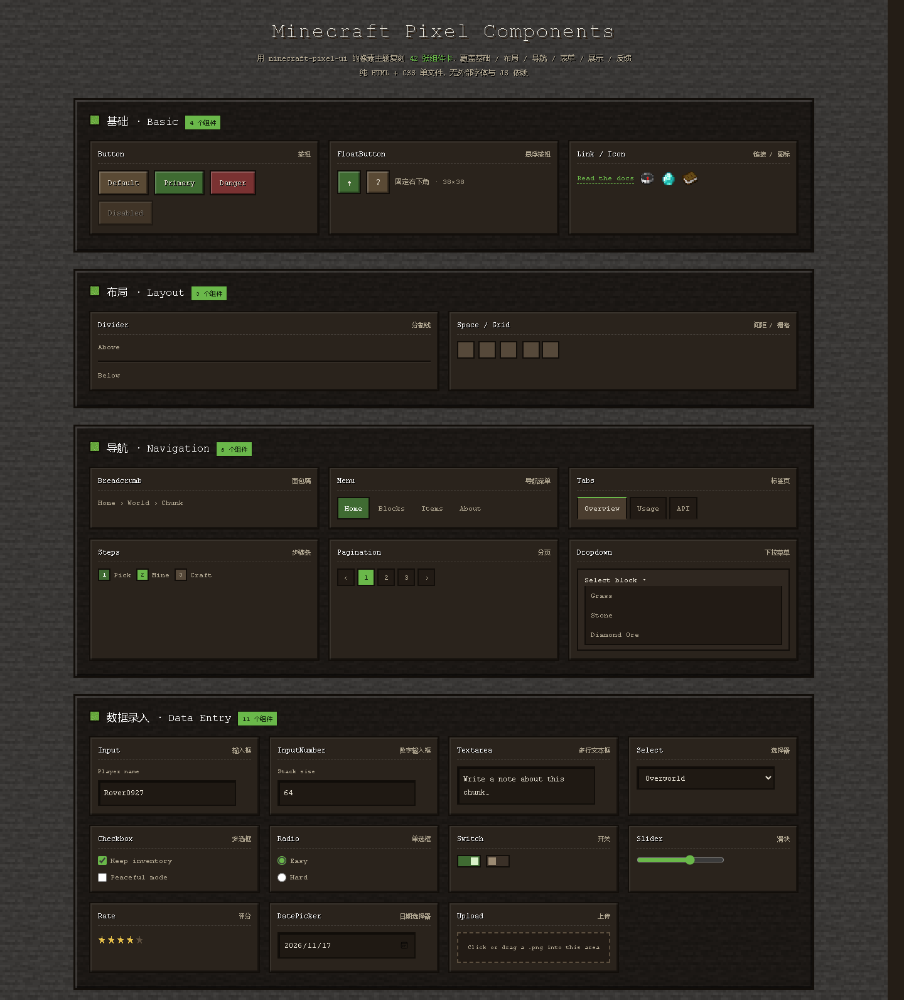
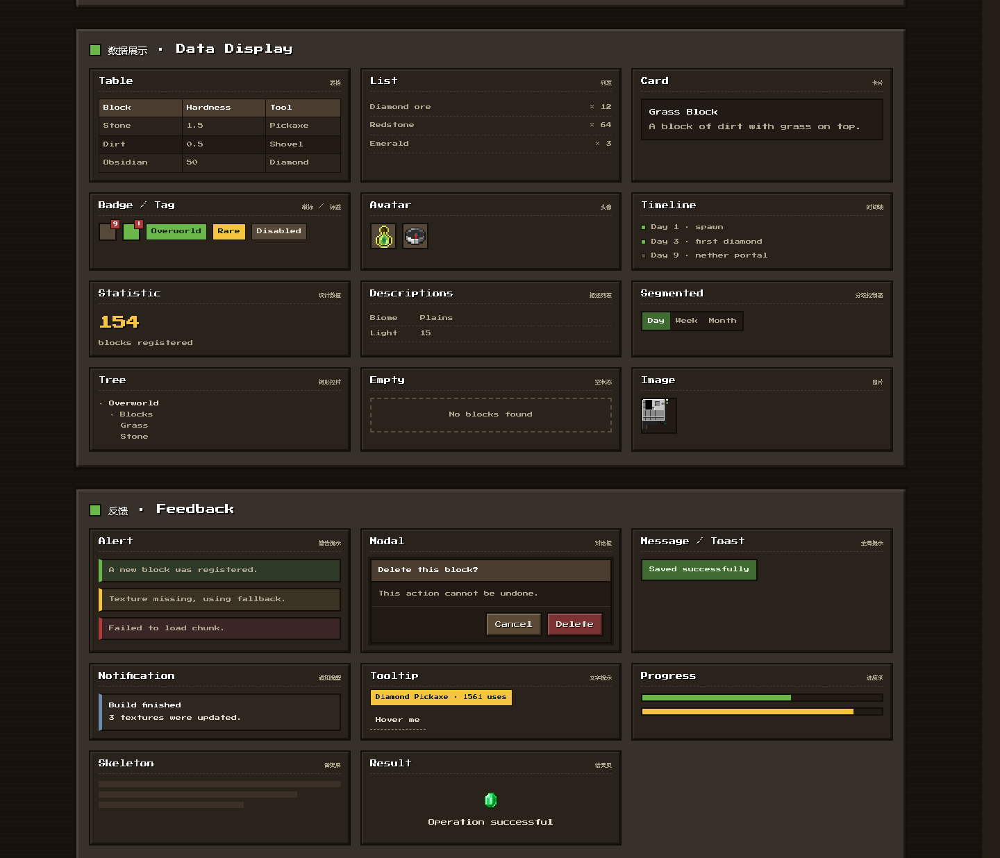
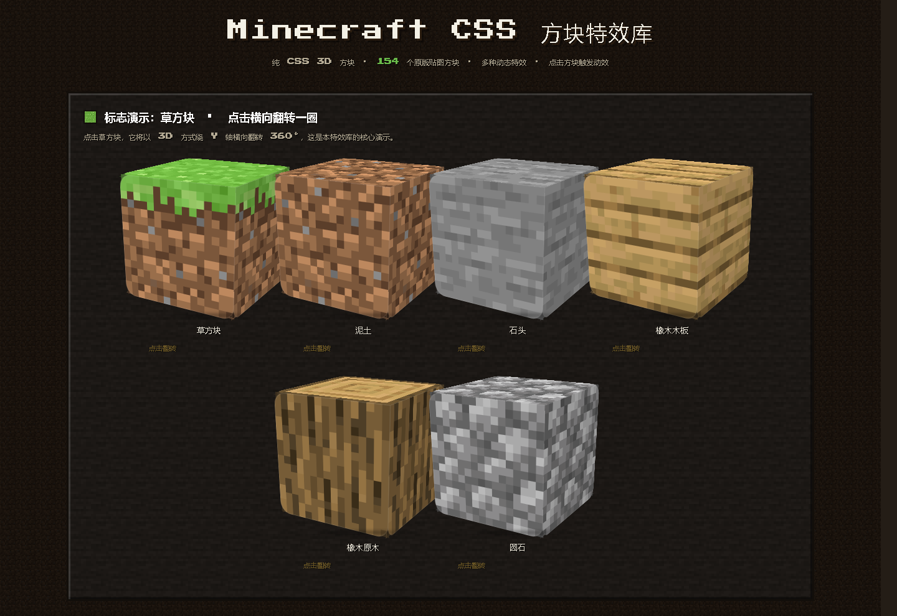
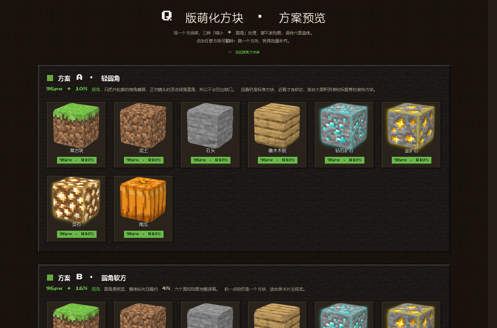
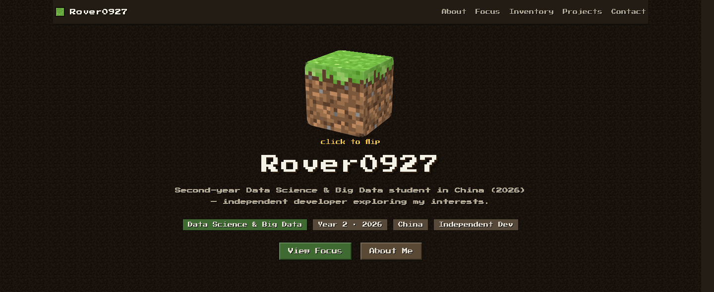
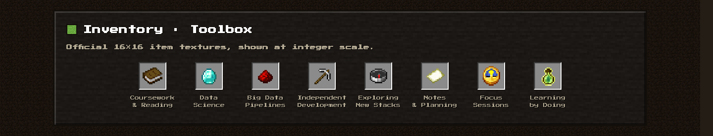
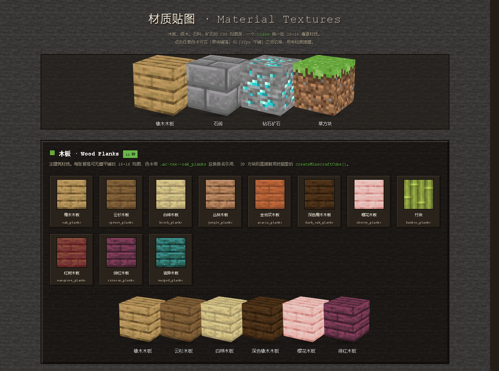
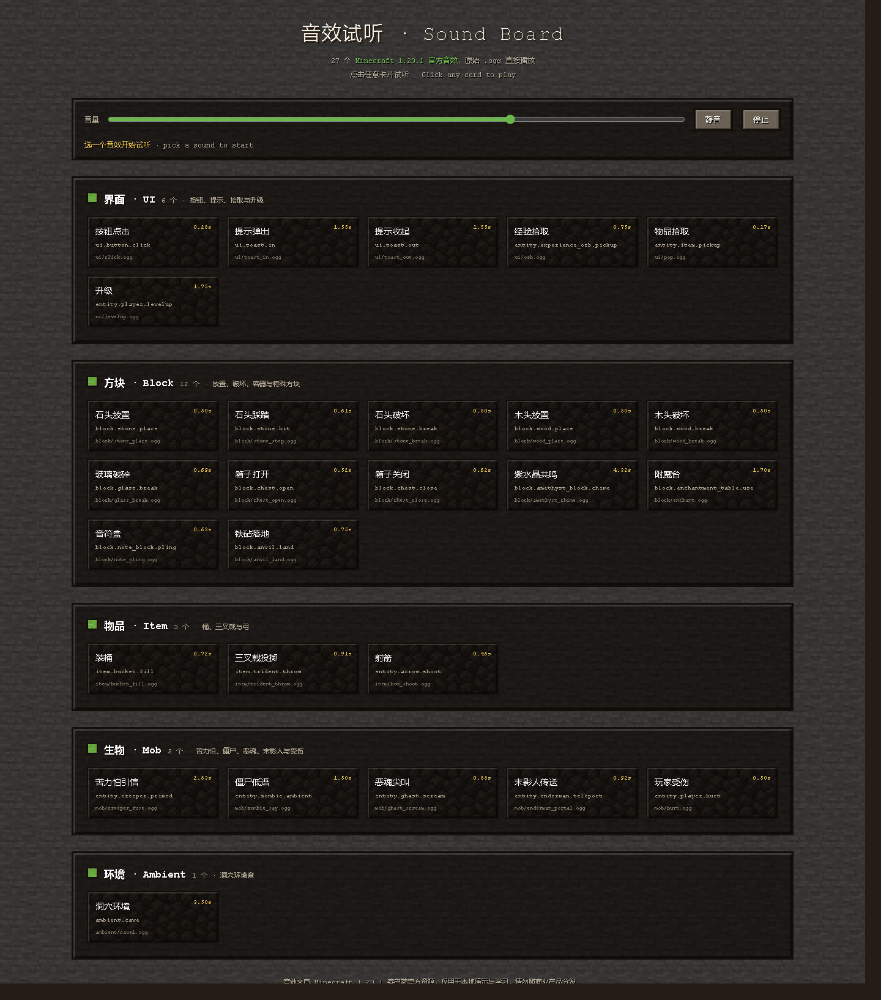
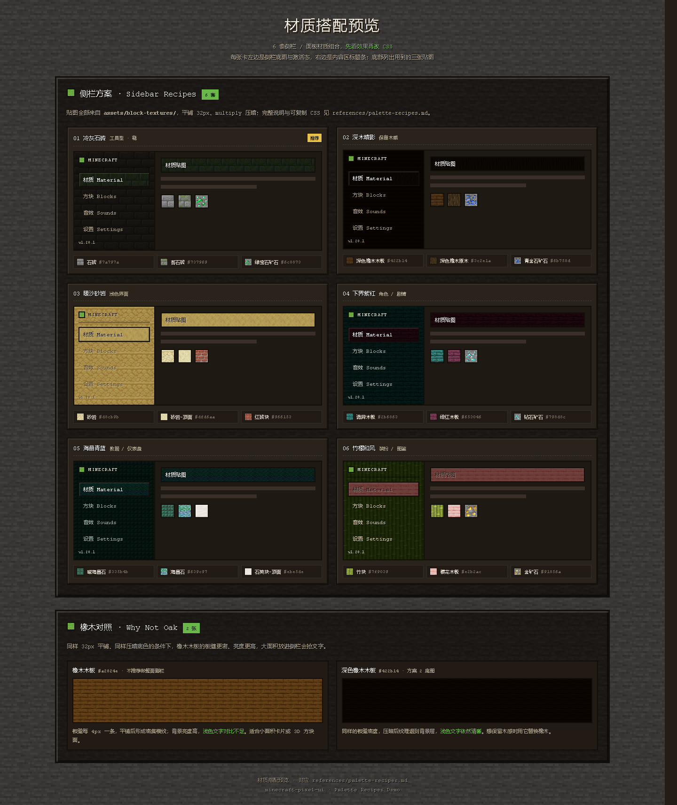

**English** · [简体中文](./README.zh-CN.md)

# Minecraft Pixel UI

A verified Minecraft pixel-UI skill pack: pure-CSS 3D blocks, vanilla texture registry, animation recipes, Q-style rounded blocks, item icons and GUI panel assets, plus the pitfalls we hit and how we fixed them.

> GitHub only renders `README.md`. Chinese version: [README.zh-CN.md](./README.zh-CN.md). The skill definition lives in [SKILL.md](./SKILL.md) and is the source of truth for agents.

## Components

Common front-end components rebuilt with this skill's theme. The demo is a single file, no build step and no dependencies — open [demo/components.html](https://rover0927.github.io/minecraft-pixel-ui/demo/components.html) in a browser.

About 44 components across 6 groups:

| Group | Components |
| --- | --- |
| Basic | Button, FloatButton, Link, Icon |
| Layout | Divider, Space, Grid |
| Navigation | Breadcrumb, Menu, Tabs, Steps, Pagination, Dropdown |
| Data Entry | Input, InputNumber, Textarea, Select, Checkbox, Radio, Switch, Slider, Rate, DatePicker, Upload |
| Data Display | Table, List, Card, Badge, Tag, Avatar, Timeline, Statistic, Descriptions, Segmented, Tree, Empty, Image |
| Feedback | Alert, Modal, Message, Toast, Notification, Tooltip, Progress, Skeleton, Result |

See the [front-end component name reference](#front-end-component-name-reference) below for the full English/Chinese mapping.

### Component quick reference

| English | 中文 | Group |
| --- | --- | --- |
| Button | 按钮 | Basic |
| FloatButton | 悬浮按钮 | Basic |
| Link | 链接 | Basic |
| Icon | 图标 | Basic |
| Divider | 分割线 | Layout |
| Space | 间距 | Layout |
| Grid | 栅格 | Layout |
| Breadcrumb | 面包屑 | Navigation |
| Menu | 导航菜单 | Navigation |
| Tabs | 标签页 | Navigation |
| Steps | 步骤条 | Navigation |
| Pagination | 分页 | Navigation |
| Dropdown | 下拉菜单 | Navigation |
| Input | 输入框 | Data Entry |
| InputNumber | 数字输入框 | Data Entry |
| Textarea | 多行文本框 | Data Entry |
| Select | 选择器 | Data Entry |
| Checkbox | 多选框 | Data Entry |
| Radio | 单选框 | Data Entry |
| Switch | 开关 | Data Entry |
| Slider | 滑块 | Data Entry |
| Rate | 评分 | Data Entry |
| DatePicker | 日期选择器 | Data Entry |
| Upload | 上传 | Data Entry |
| Table | 表格 | Data Display |
| List | 列表 | Data Display |
| Card | 卡片 | Data Display |
| Badge | 徽标数 | Data Display |
| Tag | 标签 | Data Display |
| Avatar | 头像 | Data Display |
| Timeline | 时间轴 | Data Display |
| Statistic | 统计数值 | Data Display |
| Descriptions | 描述列表 | Data Display |
| Segmented | 分段控制器 | Data Display |
| Tree | 树形控件 | Data Display |
| Empty | 空状态 | Data Display |
| Image | 图片 | Data Display |
| Alert | 警告提示 | Feedback |
| Modal | 对话框 | Feedback |
| Message / Toast | 全局提示 | Feedback |
| Notification | 通知提醒框 | Feedback |
| Tooltip | 文字提示 | Feedback |
| Progress | 进度条 | Feedback |
| Skeleton | 骨架屏 | Feedback |
| Result | 结果页 | Feedback |

## Showcase

### MC CSS block gallery

154 vanilla textures, 6 faces, flip / spin / hover / glow / breathe animations — all pure CSS.

### Q-style rounded blocks

96px with a 10% radius: only the outer silhouette is rounded, the front vertex stays sharp, and inner cores seal the corner gaps. Validated against three radius levels.

### Personal homepage

Block hero + inventory-style toolbox + project cards, showing how the skill composes in a real page.

### Material textures

43 vanilla 16×16 textures exposed as `.mc-tex--<block>` classes; click any swatch to toggle 32px tiling and check seams.

### Sound board

27 vanilla 1.20.1 sounds — UI, block, item, mob and ambient — wired to click-to-play cards with volume, mute and stop controls.

### Material pairings

Six ready-made sidebar recipes — stone bricks, dark oak, sandstone, nether, prismarine and bamboo/cherry — each previewed as a mock sidebar with its accent texture and parts list.

## Contents

| Path | Description |
| --- | --- |
| [SKILL.md](./SKILL.md) | Skill entry: triggers, assets, core workflow, hard constraints |
| `assets/minecraft-blocks.css` | Cube and animation framework, drop next to your page |
| `assets/blocks.js` | Texture registry + `createMinecraftCube` / `playAnim` / `bindClickFlip` |
| `assets/index-template.html` | MC-themed page skeleton with four gallery sections wired up |
| [demo/components.html](https://rover0927.github.io/minecraft-pixel-ui/demo/components.html) | Component gallery: ~44 MC-styled components in 6 groups |
| [demo/textures.html](https://rover0927.github.io/minecraft-pixel-ui/demo/textures.html) | Material swatches with `.mc-tex` classes, tiling check, and 3D blocks |
| [demo/sounds.html](https://rover0927.github.io/minecraft-pixel-ui/demo/sounds.html) | Sound board: 27 vanilla sounds, click any card to play and hear it |
| [demo/palette.html](https://rover0927.github.io/minecraft-pixel-ui/demo/palette.html) | Material pairing preview: six sidebar recipes with live texture mockups |
| `assets/item-icons/` | 82 16×16 vanilla item icons for inventory / crafting / backpack UI |
| `assets/gui/` | 4 256×256 container backgrounds: inventory, crafting table, furnace, generic 54-slot |
| `assets/block-textures/` | 43 16×16 block textures: 11 planks, 6 logs, 11 building, 7 natural, 8 ores |
| `assets/sounds/` | 27 vanilla 1.20.1 sounds: 6 UI, 12 block, 3 item, 5 mob, 1 ambient |
| `docs/showcase/` | All showcase screenshots embedded in this README |
| [references/cube-framework.md](./references/cube-framework.md) | DOM contract, API, animation patterns, Q-style rounding layer |
| [references/ui-theme.md](./references/ui-theme.md) | Page theme: palette, typography, panels, grid |
| [references/asset-catalog.md](./references/asset-catalog.md) | Asset layout and item-icon usage |
| [references/palette-recipes.md](./references/palette-recipes.md) | Texture pairing recipes for sidebars, panels, cards |
| [references/pitfalls.md](./references/pitfalls.md) | Reproduced issues: symptoms, root causes, fixes |

## Features

- Pure-CSS 3D cubes: flip, spin, hover, glow, breathe, flowing water
- Vanilla 16×16 textures, integer scaling, per-face shading for orientation
- Q-style rounded blocks: only the silhouette is rounded, the front vertex stays sharp, textured cores seal the gaps
- Inventory / backpack / crafting-table UI with vanilla-style slots
- Material texture utility classes: `.mc-tex` base + `.mc-tex--<block>` per-texture, with a tiling check class
- Pixel-art takes on common front-end components (buttons, forms, tables, modals, alerts…)
- Documented fixes for face misalignment, `filter` flattening, animations that never reset, corner notches, click-flip lifecycle

## Quick start

1. Copy `assets/minecraft-blocks.css` and `assets/blocks.js` next to your page.
2. Point `TEX_PATH` at the top of `blocks.js` to your texture folder.
3. Start from `assets/index-template.html` and call `createMinecraftCube(key, opts)`.
4. For inventory UI, copy `assets/item-icons/` into your page assets and lay out `.mc-slot` cells.
5. For material swatches, copy `assets/block-textures/` and add `.mc-tex--<block>` classes; see [demo/textures.html](https://rover0927.github.io/minecraft-pixel-ui/demo/textures.html).
6. Use [demo/components.html](https://rover0927.github.io/minecraft-pixel-ui/demo/components.html) as the style reference for components.

Full workflow: [SKILL.md](./SKILL.md).

## Front-end component name reference

> Mostly Ant Design / Element Plus. Naming varies slightly between libraries.

### General / Basics

| English | 中文 |
| --- | --- |
| Button | 按钮 |
| FloatButton | 悬浮按钮 |
| Icon | 图标 |
| Typography | 排版 |
| Link | 链接 |
| Text | 文本 |

### Layout

| English | 中文 |
| --- | --- |
| Divider | 分割线 |
| Flex | 弹性布局 |
| Grid | 栅格 |
| Layout | 布局 |
| Space | 间距 |
| Splitter | 分隔面板 |
| Container | 布局容器 |
| Scrollbar | 滚动条 |

### Navigation

| English | 中文 |
| --- | --- |
| Menu | 导航菜单 |
| Breadcrumb | 面包屑 |
| Dropdown | 下拉菜单 |
| Pagination | 分页 |
| Steps | 步骤条 |
| Tabs | 标签页 / 选项卡 |
| Anchor | 锚点 |
| Affix | 固钉 |
| Backtop | 回到顶部 |
| PageHeader | 页头 |

### Data Entry (Forms)

| English | 中文 |
| --- | --- |
| Form | 表单 |
| Input | 输入框 |
| InputNumber | 数字输入框 |
| Textarea | 多行文本框 |
| Select | 选择器 |
| Cascader | 级联选择器 |
| TreeSelect | 树形选择 |
| Checkbox | 多选框 / 复选框 |
| Radio | 单选框 |
| Switch | 开关 |
| Slider | 滑块 / 滑动输入条 |
| Rate | 评分 |
| DatePicker | 日期选择器 |
| TimePicker | 时间选择器 |
| ColorPicker | 颜色选择器 |
| Upload | 上传 |
| Transfer | 穿梭框 |
| AutoComplete | 自动补全输入框 |
| Mentions | 提及 |

### Data Display

| English | 中文 |
| --- | --- |
| Table | 表格 |
| List | 列表 |
| Card | 卡片 |
| Collapse | 折叠面板 |
| Carousel | 走马灯 / 轮播图 |
| Avatar | 头像 |
| Badge | 徽标数 / 徽章 |
| Tag | 标签 |
| Tree | 树形控件 |
| Timeline | 时间轴 |
| Descriptions | 描述列表 |
| Statistic | 统计数值 |
| Segmented | 分段控制器 |
| Empty | 空状态 |
| Image | 图片 |
| Calendar | 日历 |
| QRCode | 二维码 |

### Feedback

| English | 中文 |
| --- | --- |
| Alert | 警告提示 |
| Modal / Dialog | 对话框（模态弹窗） |
| Drawer | 抽屉 |
| Message | 全局提示 / 消息提示 |
| Notification | 通知提醒框 |
| Toast | 轻提示 |
| Popconfirm | 气泡确认框 |
| Popover | 气泡卡片 / 弹出框 |
| Tooltip | 文字提示 |
| Progress | 进度条 |
| Spin / Loading | 加载中 |
| Skeleton | 骨架屏 |
| Result | 结果页 |
| Watermark | 水印 |

### Others

| English | 中文 |
| --- | --- |
| Tour | 漫游式引导 |
| ConfigProvider | 全局化配置 |

### Notes

- Naming differs across libraries: Modal (AntD) is Dialog in Element Plus; Carousel is called both “走马灯” and “轮播图”.
- Feedback components are easy to mix up: Alert is persistent, Toast is fleeting, Notification queues up, Modal blocks with an overlay, Drawer slides in from the side.

## Assets

Item icons and GUI backgrounds come from the Minecraft client resource pack (`client-extra`). Use them for local demos, prototypes and learning only; do not redistribute them with commercial products. Scale only by integer multiples and pair with `image-rendering: pixelated`.

## License

Code and documentation are released under the [MIT License](./LICENSE). Minecraft textures, icons and sounds belong to Mojang/Microsoft and are included for local demos and learning only — see the asset note above.
