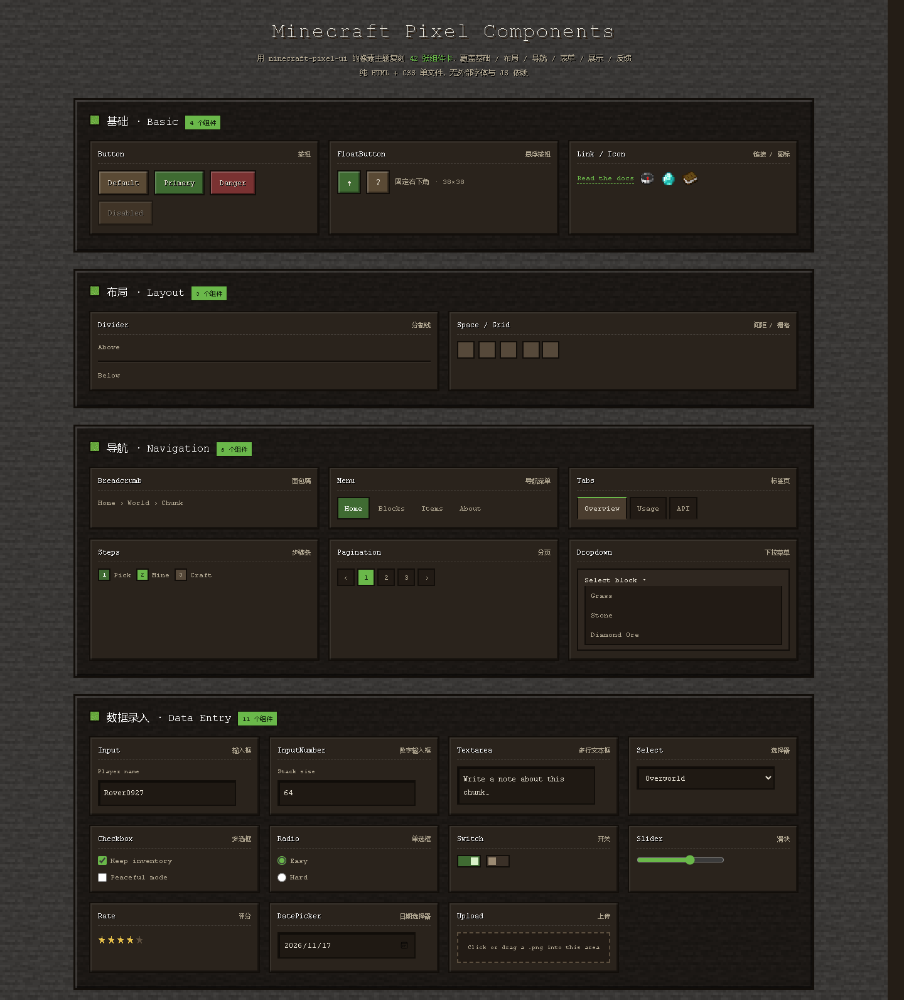
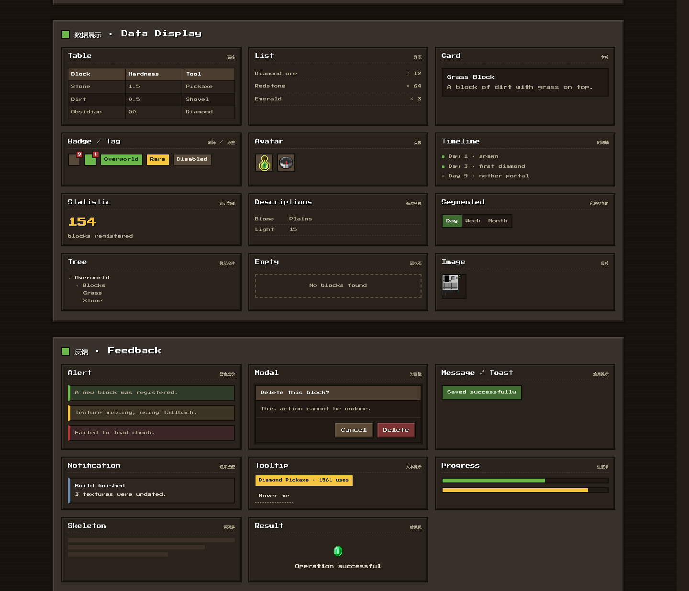
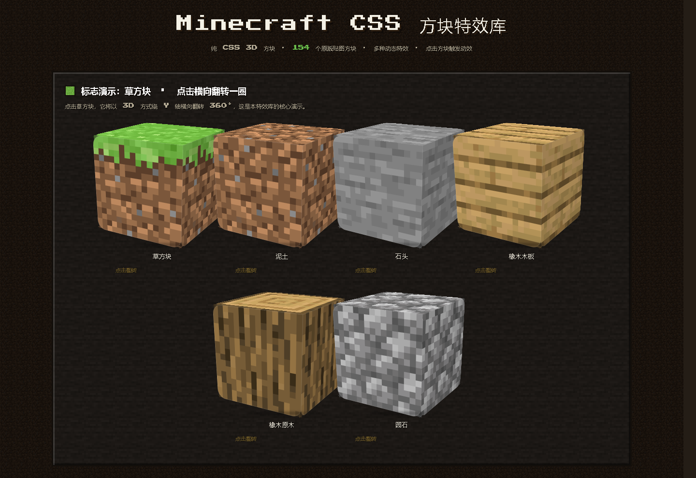
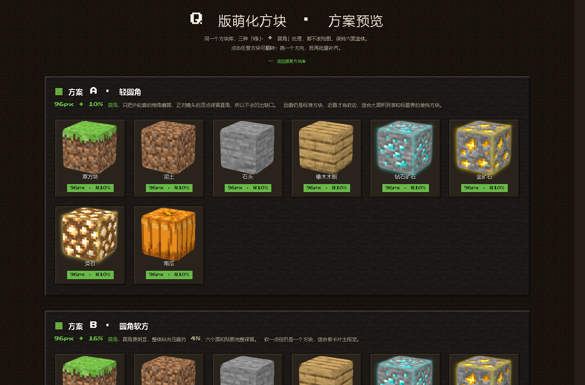
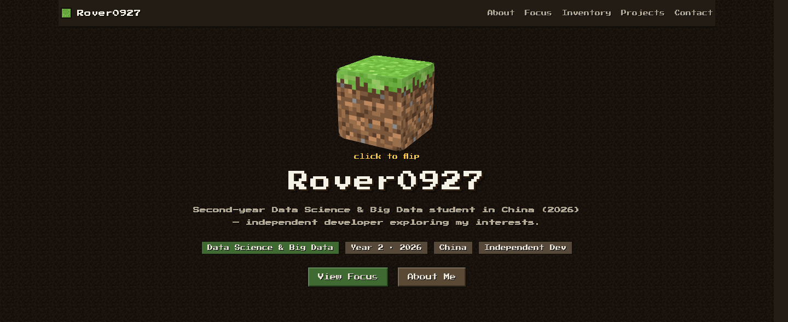
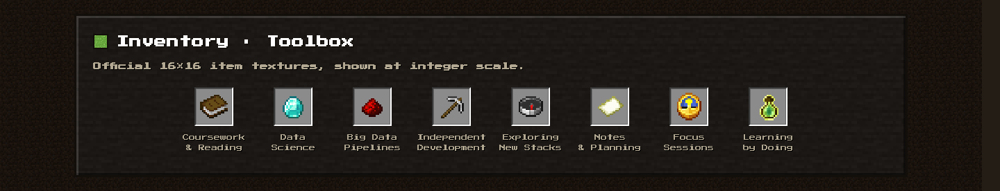
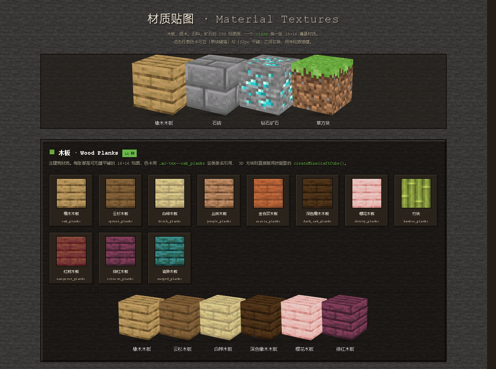
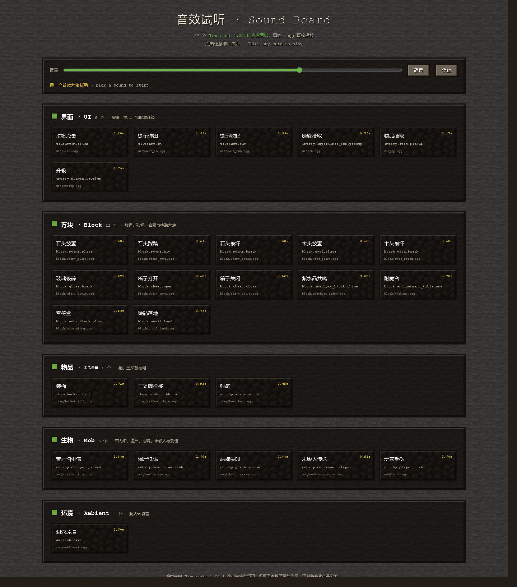

[English](./README.md) · **简体中文**

# Minecraft Pixel UI

一套已验证的 Minecraft 像素 UI 技能包：纯 CSS 3D 方块、原版贴图注册表、动画配方、Q 版圆角处理、物品图标与 GUI 面板素材，以及踩过的坑和修复结论。

> GitHub 仓库首页只会渲染 `README.md`，中文版在 [README.zh-CN.md](./README.zh-CN.md)，技能主体定义在 [SKILL.md](./SKILL.md)。

## 组件展示 · Components

用本技能的主题复刻常见前端组件，页面在 [demo/components.html](./demo/components.html)，无构建、无依赖，浏览器直接打开即可。

覆盖 6 组约 44 个组件：

| 分组 | 组件 |
| --- | --- |
| 基础 Basic | Button、FloatButton、Link、Icon |
| 布局 Layout | Divider、Space、Grid |
| 导航 Navigation | Breadcrumb、Menu、Tabs、Steps、Pagination、Dropdown |
| 录入 Data Entry | Input、InputNumber、Textarea、Select、Checkbox、Radio、Switch、Slider、Rate、DatePicker、Upload |
| 展示 Data Display | Table、List、Card、Badge、Tag、Avatar、Timeline、Statistic、Descriptions、Segmented、Tree、Empty、Image |
| 反馈 Feedback | Alert、Modal、Message、Toast、Notification、Tooltip、Progress、Skeleton、Result |

完整中英文名称对照见文末[前端组件中英文名称对照表](#前端组件中英文名称对照表)。

### 组件中英文速查

| 英文 | 中文 | 分组 |
| --- | --- | --- |
| Button | 按钮 | 基础 |
| FloatButton | 悬浮按钮 | 基础 |
| Link | 链接 | 基础 |
| Icon | 图标 | 基础 |
| Divider | 分割线 | 布局 |
| Space | 间距 | 布局 |
| Grid | 栅格 | 布局 |
| Breadcrumb | 面包屑 | 导航 |
| Menu | 导航菜单 | 导航 |
| Tabs | 标签页 | 导航 |
| Steps | 步骤条 | 导航 |
| Pagination | 分页 | 导航 |
| Dropdown | 下拉菜单 | 导航 |
| Input | 输入框 | 录入 |
| InputNumber | 数字输入框 | 录入 |
| Textarea | 多行文本框 | 录入 |
| Select | 选择器 | 录入 |
| Checkbox | 多选框 | 录入 |
| Radio | 单选框 | 录入 |
| Switch | 开关 | 录入 |
| Slider | 滑块 | 录入 |
| Rate | 评分 | 录入 |
| DatePicker | 日期选择器 | 录入 |
| Upload | 上传 | 录入 |
| Table | 表格 | 展示 |
| List | 列表 | 展示 |
| Card | 卡片 | 展示 |
| Badge | 徽标数 | 展示 |
| Tag | 标签 | 展示 |
| Avatar | 头像 | 展示 |
| Timeline | 时间轴 | 展示 |
| Statistic | 统计数值 | 展示 |
| Descriptions | 描述列表 | 展示 |
| Segmented | 分段控制器 | 展示 |
| Tree | 树形控件 | 展示 |
| Empty | 空状态 | 展示 |
| Image | 图片 | 展示 |
| Alert | 警告提示 | 反馈 |
| Modal | 对话框 | 反馈 |
| Message / Toast | 全局提示 | 反馈 |
| Notification | 通知提醒框 | 反馈 |
| Tooltip | 文字提示 | 反馈 |
| Progress | 进度条 | 反馈 |
| Skeleton | 骨架屏 | 反馈 |
| Result | 结果页 | 反馈 |

## 示例页面 · Showcase

### MC CSS 方块特效库

154 个方块贴图、6 个朝向、翻转 / 旋转 / 悬浮 / 发光 / 呼吸动画，全部纯 CSS。

### Q 版圆角方案

96px / 10% 圆角只磨外轮廓，近顶点保留直角，内芯补角缝；三档圆角对照验证。

### 个人主页

方块首屏 + 物品栏工具箱 + 项目卡片，展示技能在真实页面里的组合方式。

### 材质贴图

43 张原版 16×16 贴图，用 `.mc-tex--<block>` 类切换；点击色卡可切到 32px 平铺，检查接缝。

### 音效试听

27 个 1.20.1 原版音效：界面、方块、物品、生物、环境，点击卡片即可试听，带音量、静音与停止控制。

## 内容

| 路径 | 说明 |
| --- | --- |
| [SKILL.md](./SKILL.md) | 技能入口：触发条件、目录资源、核心工作流、硬约束 |
| `assets/minecraft-blocks.css` | 立方体与动画框架，可直接复制到页面同目录 |
| `assets/blocks.js` | 贴图注册表 + `createMinecraftCube` / `playAnim` / `bindClickFlip` |
| `assets/index-template.html` | 带 MC 像素主题的页面骨架，含四个画廊区块的引导脚本 |
| [demo/components.html](./demo/components.html) | 组件展示页：6 组约 44 个 MC 风格组件 |
| [demo/textures.html](./demo/textures.html) | 材质色卡：`.mc-tex` 类、平铺检查、3D 方块 |
| [demo/sounds.html](./demo/sounds.html) | 音效试听页：27 个原版音效，点击卡片即可播放 |
| `assets/item-icons/` | 82 个 16×16 官方物品图标，用于物品栏、合成表、背包 UI |
| `assets/gui/` | 4 张 256×256 容器背景：背包、工作台、熔炉、54 格通用容器 |
| `assets/block-textures/` | 43 张 16×16 方块贴图：木板 11、原木 6、石料 11、自然 7、矿石 8 |
| `assets/sounds/` | 27 个 1.20.1 原版音效：界面 6、方块 12、物品 3、生物 5、环境 1 |
| `docs/showcase/` | README 中嵌入的全部展示截图 |
| [references/cube-framework.md](./references/cube-framework.md) | DOM 契约、API、动画写法、Q 版圆角扩展层 |
| [references/ui-theme.md](./references/ui-theme.md) | 页面主题：配色、字体、面板、栅格 |
| [references/asset-catalog.md](./references/asset-catalog.md) | 素材目录与物品图标用法 |
| [references/pitfalls.md](./references/pitfalls.md) | 已定位问题的现象、根因与修法 |

## 能做什么

- 纯 CSS 3D 六面立方体：翻转、旋转、悬浮、发光、呼吸、水流动画
- 原版 16×16 贴图，整数倍像素缩放，六面朝向明暗
- Q 版圆角方块：只磨外轮廓，近顶点保留直角，贴图内芯补角缝
- 物品栏 / 背包 / 合成台 UI，槽位复刻原版样式
- 方块贴图材质类：`.mc-tex` 基础类 + `.mc-tex--<block>` 单材质类，附平铺接缝检查
- 常见前端组件（按钮、表单、表格、弹窗、提示等）的像素风复刻
- 已排查：面错位、filter 拍平、动画不恢复、圆角凹口、点击翻转生命周期

## 快速开始

1. 复制 `assets/minecraft-blocks.css`、`assets/blocks.js` 到页面同目录。
2. 把素材目录填进 `blocks.js` 顶部的 `TEX_PATH`。
3. 以 `assets/index-template.html` 为骨架，用 `createMinecraftCube(key, opts)` 生成方块。
4. 需要物品栏时，把 `assets/item-icons/` 复制到页面资源目录，按 `.mc-slot` 摆放。
5. 需要材质色卡时，复制 `assets/block-textures/` 并补 `.mc-tex--<block>` 类，参考 `demo/textures.html`。
6. 组件外观参考 `demo/components.html` 里的样式与结构。

更完整的流程见 [SKILL.md](./SKILL.md) 的「核心工作流」。

## 前端组件中英文名称对照表

> 以 Ant Design / Element Plus 为主，部分组件在不同库叫法略有差异

### 通用 / 基础

| 英文 | 中文 |
| --- | --- |
| Button | 按钮 |
| FloatButton | 悬浮按钮 |
| Icon | 图标 |
| Typography | 排版 |
| Link | 链接 |
| Text | 文本 |

### 布局

| 英文 | 中文 |
| --- | --- |
| Divider | 分割线 |
| Flex | 弹性布局 |
| Grid | 栅格 |
| Layout | 布局 |
| Space | 间距 |
| Splitter | 分隔面板 |
| Container | 布局容器 |
| Scrollbar | 滚动条 |

### 导航

| 英文 | 中文 |
| --- | --- |
| Menu | 导航菜单 |
| Breadcrumb | 面包屑 |
| Dropdown | 下拉菜单 |
| Pagination | 分页 |
| Steps | 步骤条 |
| Tabs | 标签页 / 选项卡 |
| Anchor | 锚点 |
| Affix | 固钉 |
| Backtop | 回到顶部 |
| PageHeader | 页头 |

### 数据录入（表单）

| 英文 | 中文 |
| --- | --- |
| Form | 表单 |
| Input | 输入框 |
| InputNumber | 数字输入框 |
| Textarea | 多行文本框 |
| Select | 选择器 |
| Cascader | 级联选择器 |
| TreeSelect | 树形选择 |
| Checkbox | 多选框 / 复选框 |
| Radio | 单选框 |
| Switch | 开关 |
| Slider | 滑块 / 滑动输入条 |
| Rate | 评分 |
| DatePicker | 日期选择器 |
| TimePicker | 时间选择器 |
| ColorPicker | 颜色选择器 |
| Upload | 上传 |
| Transfer | 穿梭框 |
| AutoComplete | 自动补全输入框 |
| Mentions | 提及 |

### 数据展示

| 英文 | 中文 |
| --- | --- |
| Table | 表格 |
| List | 列表 |
| Card | 卡片 |
| Collapse | 折叠面板 |
| Carousel | 走马灯 / 轮播图 |
| Avatar | 头像 |
| Badge | 徽标数 / 徽章 |
| Tag | 标签 |
| Tree | 树形控件 |
| Timeline | 时间轴 |
| Descriptions | 描述列表 |
| Statistic | 统计数值 |
| Segmented | 分段控制器 |
| Empty | 空状态 |
| Image | 图片 |
| Calendar | 日历 |
| QRCode | 二维码 |

### 反馈

| 英文 | 中文 |
| --- | --- |
| Alert | 警告提示 |
| Modal / Dialog | 对话框（模态弹窗） |
| Drawer | 抽屉 |
| Message | 全局提示 / 消息提示 |
| Notification | 通知提醒框 |
| Toast | 轻提示 |
| Popconfirm | 气泡确认框 |
| Popover | 气泡卡片 / 弹出框 |
| Tooltip | 文字提示 |
| Progress | 进度条 |
| Spin / Loading | 加载中 |
| Skeleton | 骨架屏 |
| Result | 结果页 |
| Watermark | 水印 |

### 其他

| 英文 | 中文 |
| --- | --- |
| Tour | 漫游式引导 |
| ConfigProvider | 全局化配置 |

### 备注

- 同一组件在不同库叫法略有差异，例如 Modal（AntD）对应 Element Plus 的 Dialog；Carousel 有人叫“走马灯”，也有人叫“轮播图”。
- 反馈类组件易混淆：Alert 是常驻提示，Toast 一闪而过，Notification 会攒着等用户看，Modal 是遮罩式模态，Drawer 从侧边滑出。

## 素材说明

物品图标与 GUI 底图来自 Minecraft 客户端资源包（`client-extra`），仅用于本地演示、原型与学习，请勿随商业产品分发。放大只使用整数倍并配合 `image-rendering: pixelated`。
